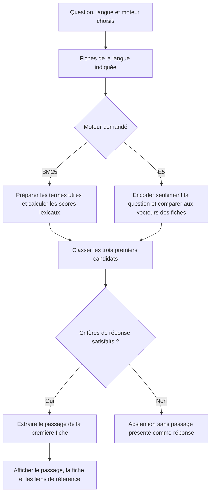

# Architecture et parcours du module documentaire

Le module documentaire de TuniScope donne accès aux méthodes, données et résultats décrits dans le projet. Il complète les fonctions de classification du sentiment et de la variété. Il ne modifie pas leurs prédictions. Cette description correspond à la version applicative évaluée les 11 et 12 novembre 2026.

## De la documentation aux fiches

La base contient 22 sujets, chacun décliné en français et en arabe standard, soit 44 fiches dans `rag/cards_v1.json`. Ces fiches sont des synthèses rédigées à partir de documents du projet. Elles ne résultent pas d'un découpage automatique de tous les fichiers Markdown. Les corpus bruts TSAC et MADAR ne constituent pas la base documentaire.

Une fiche associe un identifiant, une langue, un titre, un passage, une version, un auteur et des références. Par exemple, `tsac.fr` décrit les labels de sentiment POS et NEG. Ses références permettent de consulter le document qui étaye le passage. L'identifiant de fiche sert à citer un élément stable du catalogue.

La revue éditoriale des 44 fiches a été reçue de l'auteur. Elle porte sur leur contenu. Les références de pertinence associées aux questions restent des propositions assistées par IA, sans double jugement humain indépendant attesté. Ces deux formes de revue restent distinctes.

## Préparation au chargement

Le service `Documents.load` charge le catalogue et les paramètres de décision associés. Il contrôle leur compatibilité avec la calibration enregistrée, puis prépare les moteurs disponibles.

| Moteur | Préparation des fiches | Information conservée |
| --- | --- | --- |
| BM25 | Découpage lexical du titre et du passage, comptage des termes et des longueurs | Index lexical et statistiques nécessaires aux scores |
| E5 | Tokenisation puis encodage du titre et du passage avec le modèle multilingue épinglé | Un vecteur normalisé de 384 coordonnées par fiche |

Le code E5 utilise les préfixes `passage: ` pour les fiches et `query: ` pour les questions. Il moyenne les vecteurs des tokens utiles puis normalise le résultat. La proximité entre vecteurs utilise le cosinus.

Les vecteurs des fiches sont calculés lors du chargement du moteur et conservés en RAM. Nous ne les recalculons pas pour chaque question. Un nouveau chargement peut les recalculer. Le catalogue est assez petit pour rester en mémoire, sans base vectorielle externe. Le modèle E5, les vecteurs et l'index sont trois objets différents. Le modèle produit les représentations, les vecteurs représentent les textes et l'index permet leur recherche.

## Parcours d'une requête

La requête fournit une question, une langue et un moteur. Le service utilise la langue indiquée pour limiter les candidats aux fiches correspondantes. Cette étape ne doit pas être présentée comme une détection automatique de langue.

Le classement et la décision de répondre sont deux étapes différentes. Une bonne fiche peut figurer au deuxième rang, alors que la première est inadéquate. Le meilleur score peut aussi rester sous le critère d'acceptation. Retrouver une source parmi les trois premières ne garantit donc pas une réponse correcte dans l'interface.

La réponse actuelle reprend le passage de la première fiche acceptée. Elle ne concatène pas automatiquement les trois passages. Les liens vers les documents sont construits à partir des références présentes dans le catalogue autorisé.

## Rôle des deux moteurs

### BM25 et la politique lexicale applicative

BM25 exploite les mots communs à la question et aux fiches, leur rareté et les longueurs des documents. La politique applicative ajoute une préparation générale des questions courtes. Elle retire des mots grammaticaux, rapproche certaines variantes selon le vocabulaire existant et valorise les correspondances dans les titres. Elle ne repose pas sur une exception réservée à la question « macro-F1 ».

Pour les questions contenant au plus cinq termes utiles, la décision tient compte de la couverture pondérée des termes et de l'avance de la première fiche sur la deuxième. Pour les questions plus longues, le service conserve le seuil historique et une alternative fondée sur un score minimal accompagné d'une avance relative. Le document 69 contient les valeurs exactes et leurs conditions d'application.

BM25 reste une recherche lexicale. Une reformulation utilisant d'autres mots peut être difficile à rapprocher de la source. À l'inverse, une correspondance de mots ne garantit pas que le passage réponde à la demande précise.

### E5 et la proximité des représentations

E5 est un modèle d'embedding multilingue. Il permet de rapprocher des formulations de sens voisin à partir de leurs vecteurs, sans traduction explicite préalable de la question. Notre protocole conserve toutefois le filtre de langue des fiches.

À chaque requête, le service calcule le vecteur de la question, le compare aux vecteurs de fiches déjà disponibles puis classe les candidats. Le meilleur cosinus doit satisfaire le seuil fixé sur validation. Ce score est une proximité géométrique, sans interprétation directe comme probabilité de vérité.

## Répondre ou s'abstenir

Une méthode de recherche produit des candidats même lorsqu'aucune fiche ne répond réellement. Les critères d'acceptation cherchent à limiter ces réponses sans appui. Ils peuvent aussi rejeter une question documentée.

Les seuils initiaux ont été choisis sur la validation documentaire en équilibrant acceptation des questions documentées et rejet des questions sans réponse. La politique BM25 a ensuite évolué pendant le développement applicatif. La version mesurée sur les 40 questions a été figée avant le calcul des résultats, sans ajustement après leur consultation.

Il faut distinguer trois propriétés.

- La source existe dans le catalogue.
- Le passage affiché reproduit fidèlement cette source.
- Ce passage répond à la question posée.

Une réponse peut satisfaire les deux premières et échouer sur la troisième. Les erreurs observées sur une demande de résultat de test officiel, à laquelle le système répond avec un résultat de validation, illustrent cette limite.

## Génération étudiée et restitution retenue

Nous avons aussi évalué Qwen de base sur 20 questions de validation, avec les trois passages retrouvés par E5 ou sans contexte documentaire. Cette expérience relève de la génération augmentée par recherche. Elle utilise Qwen de base, tandis que l'adaptateur LoRA précédent apprend à produire des labels de classification.

Dans les deux conditions, aucune réponse ne satisfait le critère selon lequel toutes les citations sont pertinentes. Avec contexte, une seule réponse cite uniquement des identifiants effectivement fournis. Certaines réponses déforment aussi les faits, notamment en inventant une classe de sentiment MIXED alors que TSAC utilise NEG et POS.

L'application retient donc actuellement la recherche avec réponse extractive sourcée. Elle évite une reformulation libre par Qwen. Elle conserve néanmoins les risques de passage hors sujet et les limites de qualité des sources. L'expérimentation générative et le mode extractif servi ne doivent pas être confondus.

## Évaluation et limites

Les 60 questions rédigées pour le module se répartissent en 20 questions de validation et 40 questions de comparaison documentaire. Ces dernières comprennent 32 questions documentées et huit sans réponse. Elles sont distinctes du test officiel de classification TSAC/MADAR, encore réservé.

Sur les 40 questions, BM25 retrouve la fiche attendue parmi les trois premières pour 27 questions documentées sur 32, contre 30 pour E5. BM25 émet 28 réponses dont 19 pertinentes, E5 en émet 16 dont 13 pertinentes. E5 rejette six des huit questions sans réponse, mais refuse aussi 18 des 32 questions documentées. Les références proposées par IA et quatre formulations déjà divulguées limitent l'indépendance de cette comparaison technique.

Ces éléments contribuent à L07, L08, L09 et L10. Ils documentent une architecture et des résultats exécutés, sans certifier la clôture du jalon Silver.

## Sources du projet

- [Protocole documentaire](66_protocole_rag_documentaire.md)
- [Expérience de génération et première validation](67_resultats_validation_rag.md)
- [Politique applicative et règles de décision](69_validation_recherche_applicative.md)
- [Gel documentaire](70_protocole_gel_documentaire.md)
- [Résultats des 40 questions](71_resultats_test_documentaire.md)
- [Orchestration applicative](../App/backend/service/documents.py)
- [Préparation des questions courtes](../App/backend/service/lexical.py)
- [Index lexical](../rag/search.py)
- [Encodage dense](../rag/dense.py)
